<p align="center">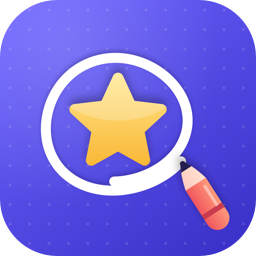</p>

<h1 align="center">SymCatch</h1>

[한국어](README.md) | **English**

An iPhone and iPad app that finds SF Symbols from a rough hand drawing.
Can't remember an icon's name? Sketch it on the canvas. SymCatch compares your drawing with about 8,000 symbols on the device and shows the 10 most similar, each with a similarity score. Tap a symbol to copy its name or its SwiftUI/UIKit code, and score 85% or higher to collect a badge for it.

All recognition and storage happen on the device. The app contains no networking code.

<p align="center">
  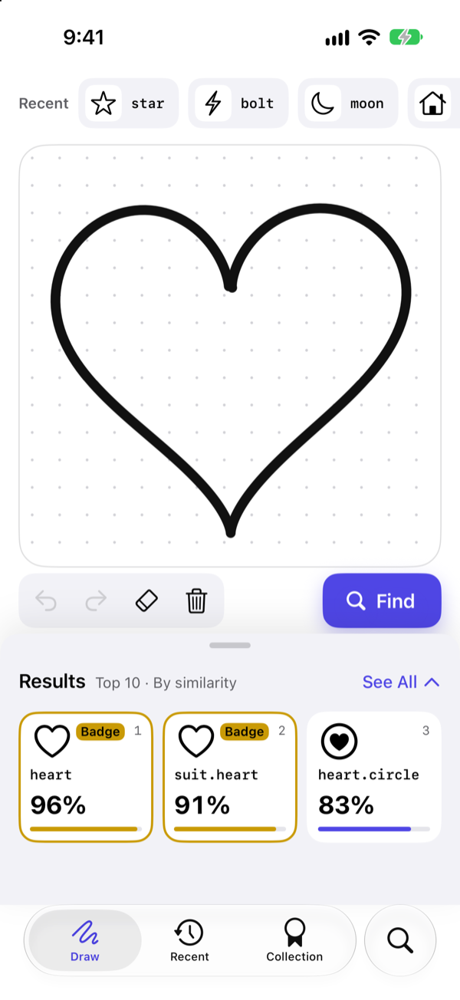
  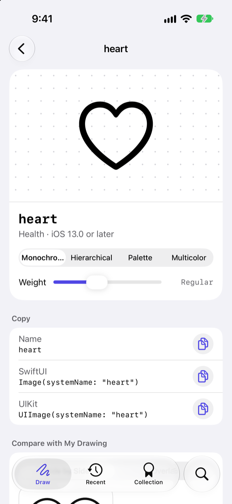
  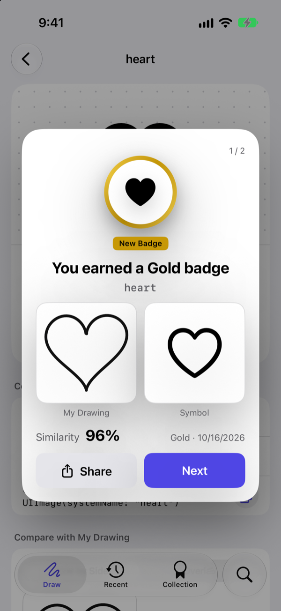
</p>

## Contents

- [Features](#features)
- [Supported devices](#supported-devices)
- [Development environment](#development-environment)
- [Build and run](#build-and-run)
- [How to use](#how-to-use)
- [Architecture](#architecture)
- [How recognition works](#how-recognition-works)
- [Project structure](#project-structure)
- [Tests](#tests)
- [Privacy](#privacy)

## Features

| Feature | Description |
| --- | --- |
| Draw to find | Searches automatically 0.6 seconds after you lift your finger and lists the Top 10 by similarity. Fill and outline variants (`heart`, `heart.fill`) are grouped into one item. |
| Symbol detail | Name, copyable `Image(systemName:)` and `UIImage(systemName:)` code, rendering mode and weight preview, variant picker, your drawing overlaid on the symbol |
| Text search | Search by English name or Korean keyword (about 1,650 words) and browse 27 categories |
| Badges | Judged by the similarity at the moment you tap a result. 85% Bronze · 90% Silver · 95% Gold · 100% Legendary. A celebration appears only when the tier goes up. |
| Achievements and streaks | 62 achievements, daily streak, collection progress by category |
| Recently found | Keeps up to 200 tapped symbols with the drawing you made |
| Adaptive layouts | iPhone portrait and landscape; iPad portrait, landscape, Split View and Stage Manager; iPhone Duo half-folded |
| Accessibility | Dynamic Type, VoiceOver, Reduce Motion, light and dark themes |

## Supported devices

| Item | Details |
| --- | --- |
| Minimum OS | iOS 17.0 · iPadOS 17.0 |
| Devices | iPhone, iPad (not offered on Mac or Apple Vision Pro) |
| iPhone Duo | On iOS 27.1 or later, detects the half-folded posture and splits into results on top and canvas below |
| Input | Finger, Apple Pencil (double-tap or squeeze to switch pen ↔ eraser) |
| Keyboard (iPad) | ⌘Z Undo · ⇧⌘Z Redo · ⌘C Copy name · ⌘⌫ Clear all |
| Network | Not required |

The symbol list follows the latest SF Symbols. Symbols that don't exist on the device's OS are hidden automatically.

## Development environment

| Item | Version / tool |
| --- | --- |
| Xcode | 27.1 |
| Swift | 6.0 (Swift 6 language mode, strict concurrency) |
| UI | SwiftUI, PencilKit (`PKCanvasView` wrapped in `UIViewRepresentable`) |
| Persistence | SwiftData (`@ModelActor` repositories, no iCloud sync) |
| Recognition | Vision (`VNGenerateImageFeaturePrintRequest`), Core Graphics, Accelerate |
| Tests | Swift Testing (unit), XCTest (UI) |
| Localization | String Catalog (`Localizable.xcstrings`), Korean and English |
| Third-party libraries | None (Apple frameworks only) |

## Build and run

```bash
git clone https://github.com/jeohong/SymCatch.git
cd SymCatch
open SymCatch.xcodeproj
```

Choose the `SymCatch` scheme and run on an iPhone or iPad simulator. The local package `Packages/SymCatchKit` is already linked to the project.

> [!NOTE]
> On first launch the app builds its symbol index on the device (about 45 seconds on iPhone 13, first time only).
> In the simulator, Vision runs on the CPU only and returns nearly identical feature vectors, so **search accuracy can only be judged on a real device.** Use the simulator to check screens and flows.

Command-line build and tests:

```bash
# Build the app
xcodebuild -project SymCatch.xcodeproj -scheme SymCatch \
  -destination 'platform=iOS Simulator,name=iPhone 17' build

# App tests (ViewModels, UI)
xcodebuild -project SymCatch.xcodeproj -scheme SymCatch \
  -destination 'platform=iOS Simulator,name=iPhone 17' test

# Package tests (Domain, Storage, Recognition)
cd Packages/SymCatchKit
xcodebuild -scheme SymCatchKit-Package \
  -destination 'platform=iOS Simulator,name=iPhone 17' test

# Check layer dependency rules
Tools/check_layers.sh
```

## How to use

<p align="center">
  
  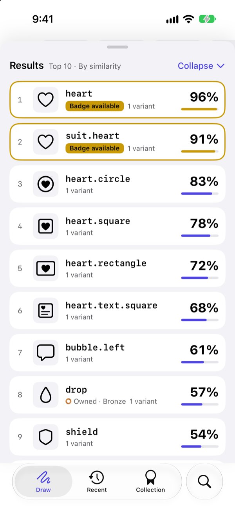
  
</p>

<p align="center">
  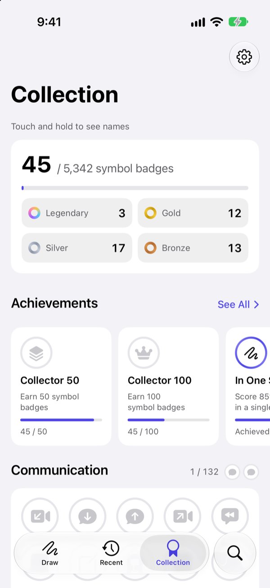
  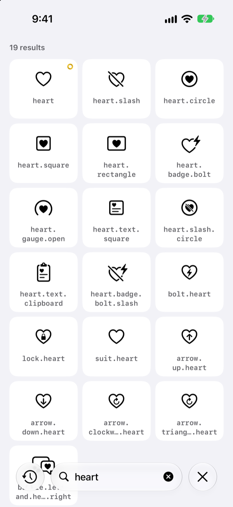
  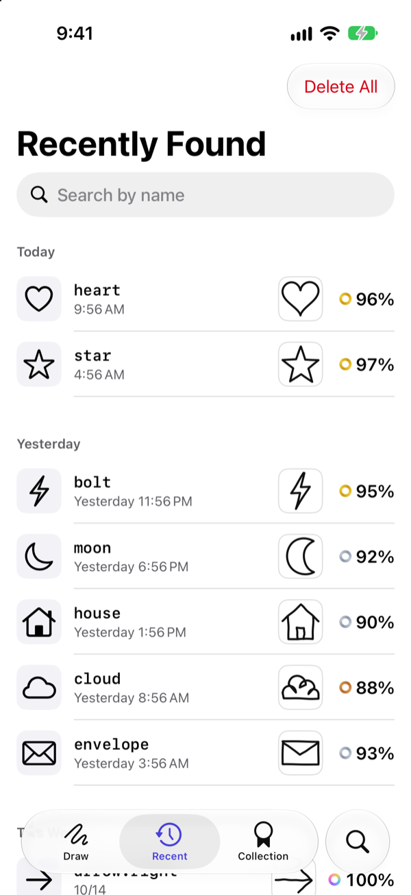
</p>

1. **First launch** — Practice by drawing a heart on the welcome screen while the symbol index is prepared.
2. **Draw** — Sketch the icon you want on the Draw tab's canvas. The search runs 0.6 seconds after you lift your finger. If the drawing is too small, you'll see "Try drawing a bit bigger."
3. **Pick a result** — Pull up the result sheet to see the Top 10. Tapping a symbol saves it to your history, and 85% or higher earns a badge.
4. **Copy** — On the detail screen, copy the name or the SwiftUI/UIKit code.
5. **Search by text** — If you vaguely remember the name, search on the Search tab, for example `heart`.
6. **Collect** — Check badges, achievements and your streak on the Collection tab.

### On every device

The same screens rearrange to fit the window size and device pose.

<p align="center">
  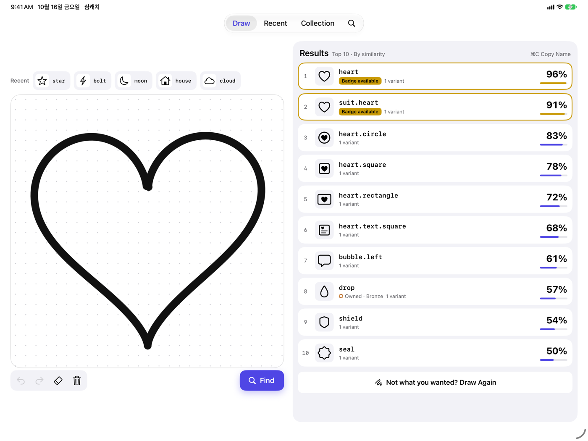
</p>

<p align="center">
  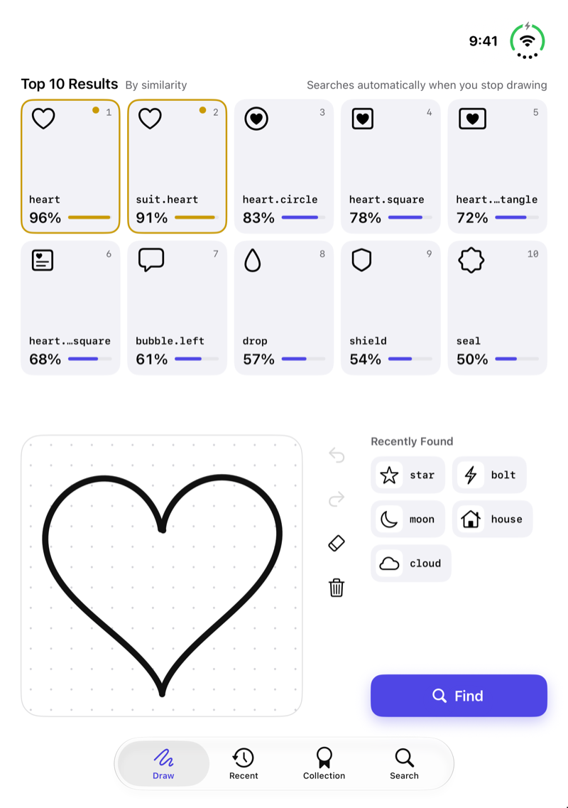
  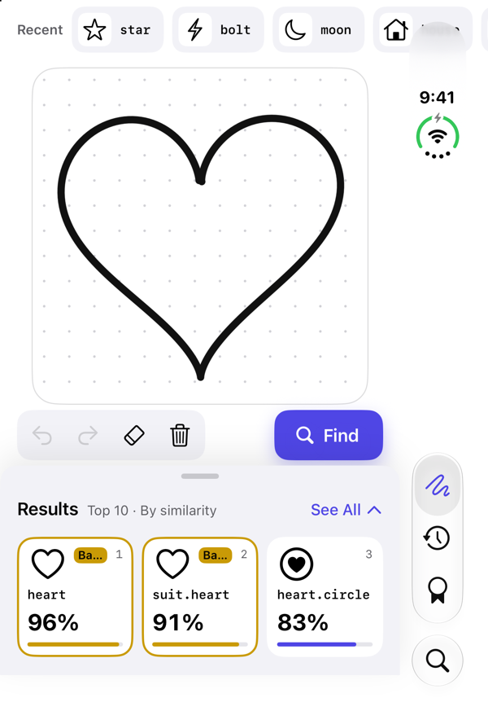
</p>

<p align="center"><sub>iPad landscape · iPhone Duo half-folded (results up / canvas down) · iPhone Duo closed (cover screen)</sub></p>

> Screenshots were taken in the simulator with the DEBUG-only demo mode (`-ScreenshotDemo`). Recognition results are meaningless in the simulator, so the demo mode fills in results and history similar to drawing a heart on a real device.

## Architecture

SymCatch uses **MVVM + Clean Architecture**. Layer boundaries are local Swift Package targets, so an `import` in the wrong direction doesn't compile.

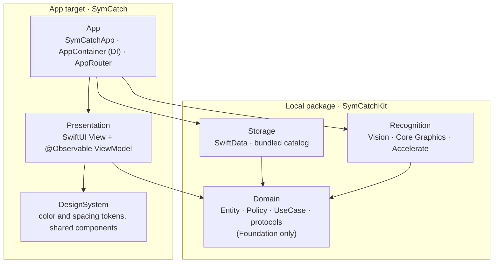

| Layer | Role | Allowed imports |
| --- | --- | --- |
| **Domain** | Entities, business rules (Policies), UseCases, repository and service protocols | `Foundation` only |
| **Storage** | SwiftData `@Model` types and mappers, repository implementations, bundled symbol catalog | Domain, SwiftData |
| **Recognition** | Preprocessing, embedding, index file, vector search | Domain, Vision, Core Graphics, Accelerate, UIKit (symbol images) |
| **Presentation** | Screens and ViewModels. Knows only UseCase protocols. | Domain, SwiftUI, PencilKit |
| **App** | Composition root that assembles every object | Everything |

Design principles:

- **Dependencies point inward to Domain.** Presentation doesn't know Storage or Recognition. Boundaries inside the app target are checked by `Tools/check_layers.sh`.
- **Rules are pure functions.** Badge tiers and awarding, score calibration, streaks, variant grouping, achievements and the "drawing too small" check all live in Domain Policies with unit tests. Time and calendar are injected.
- **One state per ViewModel.** A `@MainActor @Observable` class holds the screen as a single `state`; the View only renders it and forwards events.
- **SwiftData stays inside Storage.** `@ModelActor` repositories map models to Domain entities. Drawings are stored as normalized stroke coordinates (JSON) in the same row, not as PNG files.
- **Blocking work runs on GCD.** Vision and image rendering go through `BlockingWork` on GCD threads. If synchronous work fills every Swift concurrency thread, the app deadlocks.
- **Layout follows the container.** `DrawLayoutResolver` picks one of five layouts from the container size, size class and fold region only. It never branches on device type or orientation.

### Draw screen layouts

| Condition | Layout |
| --- | --- |
| Compact width, tall window (iPhone portrait, narrow iPad window) | Recent on top · canvas · toolbar · result sheet at the bottom |
| Wide compact window, or height under 500 pt (iPhone landscape) | Canvas on the left · vertical tool column · result list on the right |
| Regular, wide window (iPad landscape) | Canvas on the left + Top 10 always on the right |
| Regular, tall window (iPad portrait) | Canvas on top + Top 10 in a two-column grid below |
| iPhone Duo half-folded, horizontal fold | Results on top / canvas below, nothing on the fold |

## How recognition works

SymCatch uses Apple Vision image feature prints, with no custom-trained model, plus preprocessing and score corrections tuned for hand drawings.

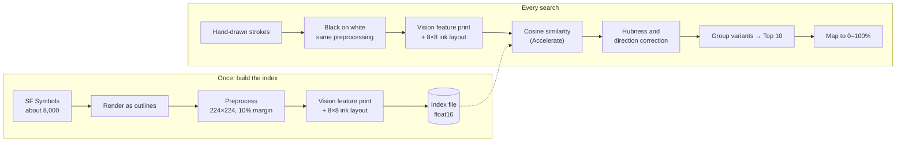

1. **Same preprocessing** — Symbols are drawn as outlines instead of filled shapes, and drawings are always black lines on white regardless of theme. Both are cropped to their content, centered, and scaled to 224×224 with a 10% margin and the same line width.
2. **Feature prints** — `VNGenerateImageFeaturePrintRequest` produces the vectors. Symbol vectors are saved to an index file as float16. The index is rebuilt when the OS version changes.
3. **Hubness correction (CSLS)** — Some symbols, like rounded squares, look similar to almost any drawing and push the right answer down. The score subtracts how similar each symbol usually is to other symbols.
4. **Direction correction** — Vision feature prints treat mirrored shapes (→ and ←) as nearly the same. A small amount of 8×8 ink-layout similarity, which keeps positions, is added to fix direction.
5. **Similarity %** — Scores are mapped to 0–100% between two thresholds (`s_low`, `s_high`) set from evaluation drawings collected on a real device.

A model-free outline distance (Chamfer) method also remains in the Recognition module as a baseline for comparison.

## Project structure

```
SymCatch/
├── SymCatch/                      App target (App + Presentation)
│   ├── App/                       Entry point, AppContainer (DI), AppRouter, tabs, (DEBUG) screenshot demo mode
│   ├── Presentation/
│   │   ├── Draw/                  Draw screen, layouts (iPhone, iPad, Duo), result sheet
│   │   ├── SymbolDetail/          Symbol detail
│   │   ├── Search/                Text search and categories
│   │   ├── Badge/                 Collection, badge detail, achievements, celebration
│   │   ├── Recent/                Recently found symbols
│   │   ├── Onboarding/            Welcome screens, index preparation
│   │   ├── Settings/              Settings
│   │   ├── Evaluation/            (DEBUG) Collect evaluation drawings, compute calibration
│   │   ├── RecognitionLab/        (DEBUG) Compare recognition methods
│   │   └── Common/                Canvas wrapper, shared state views
│   ├── DesignSystem/              Color, spacing, radius and font tokens; shared components
│   └── Resources/                 Assets, String Catalog, symbols.json, Korean keywords
├── Packages/SymCatchKit/          Local Swift Package
│   ├── Sources/Domain/            Entities · Policies · Repositories · Services · UseCases
│   ├── Sources/Storage/           SwiftData models, mappers, repositories; bundled catalog
│   ├── Sources/Recognition/       Preprocessing · embedding · index · vector search · Chamfer
│   └── Tests/                     DomainTests · StorageTests · RecognitionTests
├── SymCatchTests/                 ViewModel and layout tests (fake UseCases injected)
├── SymCatchUITests/               UI tests for the main flows
└── Tools/                         Symbol extraction, layer and keyword checks, App Store images, app icon
```

### Tools

| Script | What it does |
| --- | --- |
| `Tools/extract_symbols.swift` | Reads symbol names, categories and minimum OS from the installed SF Symbols app and writes `symbols.json`. Run it after updating the SF Symbols app. |
| `Tools/check_layers.sh` | Checks that Presentation doesn't import Storage, Recognition, SwiftData or Vision. |
| `Tools/check_korean_keywords.swift` | Checks that the Korean keyword dictionary matches the catalog. |
| `Tools/appstore/capture.sh` | Runs the demo-mode UI test (`AppStoreScreenshotUITests`) and captures the simulator screen for each scene. |
| `Tools/appstore/compose.swift` | Adds background, device frames and captions to the captures to make App Store screenshots, the header and the search result image. Scenes and captions live in `iphone.json`, `ipad.json`, `duo.json` and `banners.json`. |
| `Tools/appicon/make_icon.swift` | Draws the app icon (light, dark and tinted, 1024×1024). |

## Tests

| Target | Framework | Covers |
| --- | --- | --- |
| DomainTests | Swift Testing | Badge tiers and awarding, score calibration, streaks, variant grouping, achievements, drawing checks, UseCases |
| StorageTests | Swift Testing | In-memory SwiftData repositories, bundled catalog, file repository |
| RecognitionTests | Swift Testing | Preprocessing, rendering, ink layout, vector search, index file, deadlock regression test |
| SymCatchTests | Swift Testing | ViewModel state changes, `DrawLayoutResolver` layout choice |
| SymCatchUITests | XCTest | Draw → result → copy, badges, recent, search, settings, rotation, accessibility |

About 280 unit tests and 25 UI tests.

## Privacy

SymCatch collects no personal information. It has no analytics, advertising or crash-reporting tools. Drawings and history stay on the device and are not synced to iCloud.

---

SF Symbols is a trademark of Apple Inc. Symbol images are drawn from the system symbols installed on the device.
