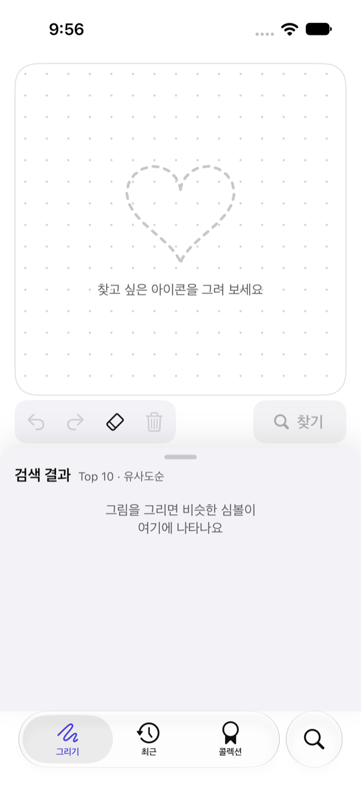
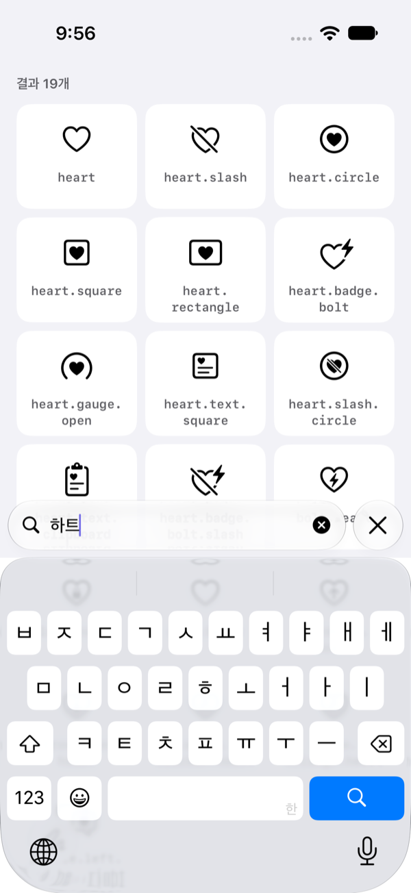
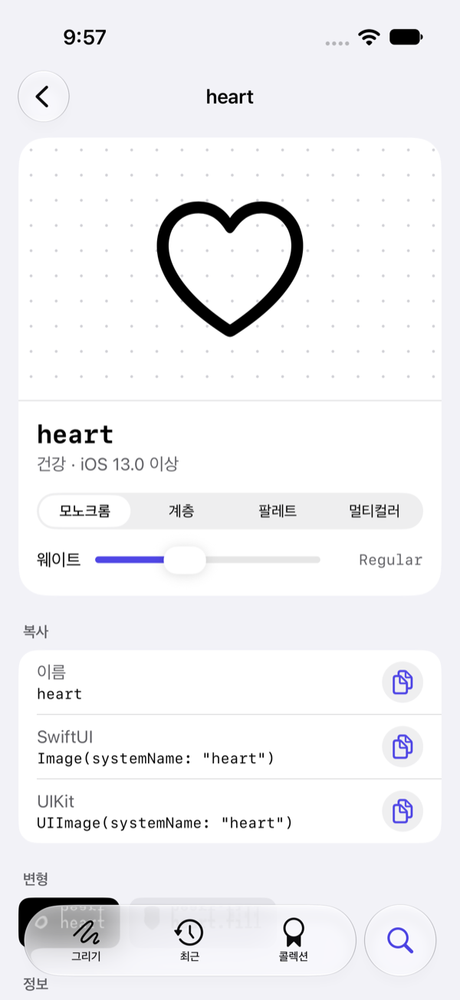
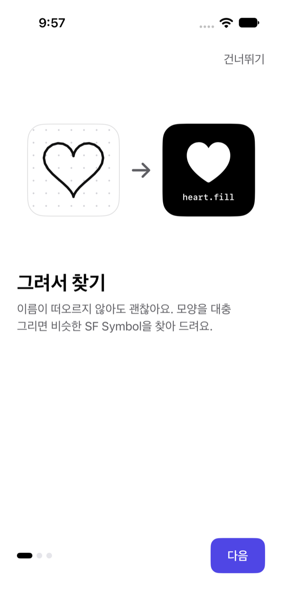
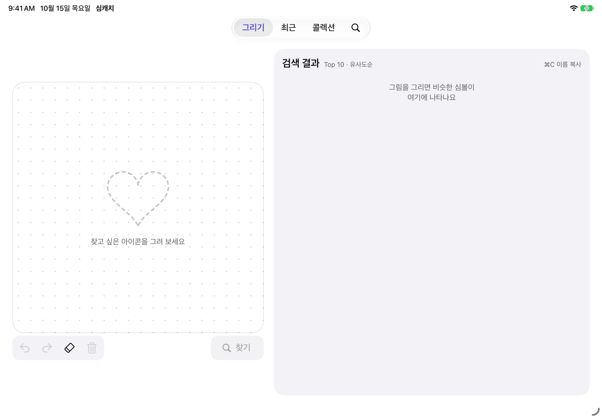
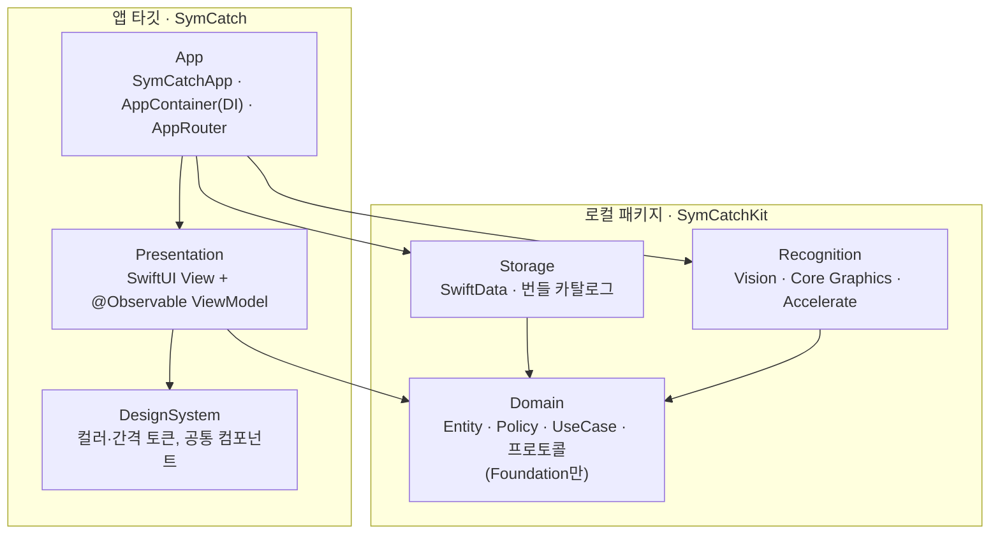
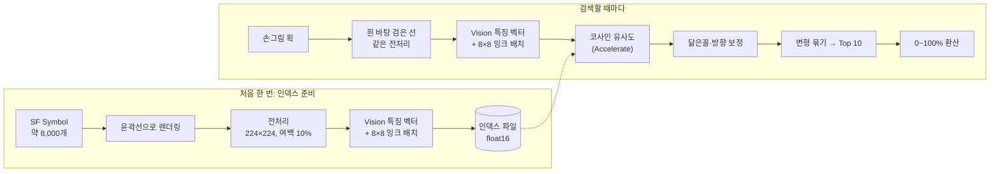

# SymCatch (심캐치)

**한국어** | [English](README.en.md)

손으로 대충 그린 그림으로 SF Symbol을 찾는 iPhone·iPad 앱입니다.
이름이 떠오르지 않는 아이콘을 캔버스에 그리면, 기기 안에서 약 8,000개 심볼과 비교해 가장 비슷한 10개를 유사도(%)와 함께 보여 줍니다. 원하는 심볼을 탭하면 이름이나 SwiftUI·UIKit 코드를 바로 복사할 수 있고, 유사도 85% 이상으로 그리면 그 심볼의 뱃지를 모을 수 있습니다.

모든 인식과 저장은 기기 안에서만 이루어지며, 앱에는 네트워크 코드가 없습니다.

<p align="center">
  
  
  
</p>

## 목차

- [주요 기능](#주요-기능)
- [지원 기기](#지원-기기)
- [개발 환경](#개발-환경)
- [빌드와 실행](#빌드와-실행)
- [사용법](#사용법)
- [아키텍처](#아키텍처)
- [인식 방식](#인식-방식)
- [프로젝트 구조](#프로젝트-구조)
- [테스트](#테스트)
- [개인정보](#개인정보)

## 주요 기능

| 기능 | 설명 |
| --- | --- |
| 그려서 찾기 | 획을 떼고 0.6초 뒤 자동으로 검색해 Top 10을 유사도순으로 보여 줍니다. 채움·테두리 변형(`heart`, `heart.fill`)은 한 항목으로 묶습니다. |
| 심볼 상세 | 이름, `Image(systemName:)`·`UIImage(systemName:)` 코드 복사, 렌더링 모드·굵기 미리보기, 변형 선택, 내 그림과 겹쳐 보기 |
| 글자로 찾기 | 영어 이름과 한국어 키워드(약 1,650개 단어)로 검색하고 27개 카테고리를 둘러봅니다. |
| 뱃지 | 결과를 탭한 순간의 유사도로 판정합니다. 85% 브론즈 · 90% 실버 · 95% 골드 · 100% 레전더리. 등급이 오를 때만 축하 화면이 뜹니다. |
| 업적·출석 | 62개 업적, 연속 출석일, 카테고리별 수집 현황 |
| 최근 찾은 심볼 | 탭한 심볼과 그때의 그림을 최대 200개까지 기기에 저장합니다. |
| 다양한 화면 | iPhone 세로·가로, iPad 세로·가로·Split View·Stage Manager, iPhone Duo 반쯤 접힘에 맞춘 배치 |
| 접근성 | Dynamic Type, VoiceOver, 동작 줄이기, 라이트·다크 테마 |

## 지원 기기

| 항목 | 내용 |
| --- | --- |
| 최소 OS | iOS 17.0 · iPadOS 17.0 |
| 기기 | iPhone, iPad (Mac·Apple Vision Pro에서는 제공하지 않음) |
| iPhone Duo | iOS 27.1 이상에서 반쯤 접힌 자세를 감지해 위 결과 · 아래 캔버스로 나눕니다. |
| 입력 | 손가락, Apple Pencil (더블탭·스퀴즈로 펜 ↔ 지우개) |
| 키보드 (iPad) | ⌘Z 되돌리기 · ⇧⌘Z 다시 하기 · ⌘C 이름 복사 · ⌘⌫ 전체 지우기 |
| 네트워크 | 필요 없음 |

심볼 목록은 최신 SF Symbols 기준이며, 기기 OS에 없는 심볼은 자동으로 제외됩니다.

## 개발 환경

| 항목 | 버전·도구 |
| --- | --- |
| Xcode | 27.1 |
| Swift | 6.0 (Swift 6 언어 모드, Strict Concurrency) |
| UI | SwiftUI, PencilKit (`PKCanvasView`를 `UIViewRepresentable`로 감쌈) |
| 저장 | SwiftData (`@ModelActor` 저장소, iCloud 동기화 없음) |
| 인식 | Vision (`VNGenerateImageFeaturePrintRequest`), Core Graphics, Accelerate |
| 테스트 | Swift Testing (단위), XCTest (UI) |
| 지역화 | String Catalog (`Localizable.xcstrings`), 한국어·영어 |
| 외부 라이브러리 | 없음 (Apple 프레임워크만 사용) |

## 빌드와 실행

```bash
git clone https://github.com/jeohong/SymCatch.git
cd SymCatch
open SymCatch.xcodeproj
```

`SymCatch` 스킴을 고르고 iPhone 또는 iPad 시뮬레이터에서 실행하면 됩니다. 로컬 패키지 `Packages/SymCatchKit`는 프로젝트에 이미 연결돼 있습니다.

> [!NOTE]
> 처음 실행하면 기기 안에서 심볼 인덱스를 만듭니다(iPhone 13 기준 약 45초, 처음 한 번만).
> 시뮬레이터의 Vision은 CPU로만 돌아 특징 벡터가 거의 같게 나오므로, **검색 결과의 정확도는 실기기에서만 확인할 수 있습니다.** 시뮬레이터에서는 화면 흐름만 확인하세요.

명령줄 빌드·테스트:

```bash
# 앱 빌드
xcodebuild -project SymCatch.xcodeproj -scheme SymCatch \
  -destination 'platform=iOS Simulator,name=iPhone 17' build

# 앱 테스트 (ViewModel·UI)
xcodebuild -project SymCatch.xcodeproj -scheme SymCatch \
  -destination 'platform=iOS Simulator,name=iPhone 17' test

# 패키지 테스트 (Domain·Storage·Recognition)
cd Packages/SymCatchKit
xcodebuild -scheme SymCatchKit-Package \
  -destination 'platform=iOS Simulator,name=iPhone 17' test

# 레이어 의존 규칙 검사
Tools/check_layers.sh
```

## 사용법

<p align="center">
  
  
  
  
</p>

1. **처음 실행** — 시작 화면에서 연습으로 하트를 그려 보고, 그동안 심볼 인덱스를 준비합니다.
2. **그리기** — 그리기 탭의 캔버스에 찾고 싶은 아이콘을 그립니다. 손을 떼면 0.6초 뒤 자동으로 찾습니다. 그림이 너무 작으면 "조금 더 크게 그려 주세요"가 뜹니다.
3. **결과 고르기** — 아래 결과 시트를 올리면 Top 10이 보입니다. 원하는 심볼을 탭하면 최근 기록에 저장되고, 85% 이상이면 뱃지를 받습니다.
4. **복사** — 상세 화면에서 이름이나 SwiftUI·UIKit 코드를 복사합니다.
5. **글자로 찾기** — 이름이 어렴풋이 떠오르면 검색 탭에서 `heart`나 `하트`처럼 찾습니다.
6. **모으기** — 콜렉션 탭에서 뱃지, 업적, 연속 출석을 확인합니다.

<p align="center">
  
</p>

## 아키텍처

**MVVM + Clean Architecture**입니다. 레이어 경계를 로컬 Swift Package의 타깃으로 나눠, 잘못된 방향의 `import`는 컴파일부터 되지 않게 했습니다.



| 레이어 | 역할 | import 허용 |
| --- | --- | --- |
| **Domain** | 엔티티, 비즈니스 규칙(Policy), UseCase, 저장소·서비스 프로토콜 | `Foundation`만 |
| **Storage** | SwiftData `@Model`과 Mapper, 저장소 구현, 번들 심볼 카탈로그 | Domain, SwiftData |
| **Recognition** | 전처리, 임베딩, 인덱스 파일, 벡터 검색 | Domain, Vision, Core Graphics, Accelerate, UIKit(심볼 이미지) |
| **Presentation** | 화면과 ViewModel. UseCase 프로토콜만 압니다. | Domain, SwiftUI, PencilKit |
| **App** | 모든 객체를 조립하는 Composition Root | 전부 |

설계 원칙:

- **의존은 안쪽(Domain)으로만.** Presentation은 Storage·Recognition을 모릅니다. 앱 타깃 안의 경계는 `Tools/check_layers.sh`로 검사합니다.
- **규칙은 순수 함수.** 뱃지 등급·지급, 점수 보정, 연속 출석, 변형 묶기, 업적 판정, 그림 부족 판정은 모두 Domain의 Policy로 두고 단위 테스트합니다. 시간과 달력은 주입합니다.
- **ViewModel은 상태 하나.** `@MainActor @Observable` 클래스가 화면 상태를 하나의 `state`로 들고, View는 렌더링과 이벤트 전달만 합니다.
- **SwiftData는 Storage 밖으로 나가지 않습니다.** `@ModelActor` 저장소가 Mapper로 Domain 엔티티로 바꿔 내보냅니다. 그림은 PNG가 아니라 정규화된 획 좌표(JSON)로 같은 행에 저장합니다.
- **무거운 동기 작업은 GCD로.** Vision·이미지 렌더링은 `BlockingWork`를 거쳐 GCD 스레드에서 돌립니다. Swift 동시성의 협력 스레드를 동기 작업이 모두 차지하면 교착되기 때문입니다.
- **레이아웃은 컨테이너 크기로.** `DrawLayoutResolver`가 컨테이너 크기·크기 클래스·접힘 영역만 보고 5가지 배치 중 하나를 고릅니다. 기기 종류나 화면 방향으로 나누지 않습니다.

### 그리기 화면 배치

| 조건 | 배치 |
| --- | --- |
| compact 너비, 세로가 긴 창 (iPhone 세로, iPad 좁은 창) | 위 최근 · 캔버스 · 도구 바 · 아래 결과 시트 |
| 가로가 긴 compact 창 또는 높이 500pt 미만 (iPhone 가로) | 왼쪽 캔버스 · 세로 도구 열 · 오른쪽 결과 목록 |
| regular, 가로가 긴 창 (iPad 가로) | 왼쪽 캔버스 + 오른쪽 Top 10 상시 표시 |
| regular, 세로가 긴 창 (iPad 세로) | 위 캔버스 + 아래 Top 10 2열 격자 |
| iPhone Duo 반쯤 접힘, 가로 접힘선 | 위 결과 / 아래 캔버스, 접힘 영역은 비움 |

## 인식 방식

학습한 모델 없이 Apple Vision의 이미지 특징 벡터를 쓰고, 손그림에 맞게 전처리와 점수 보정을 더했습니다.



1. **같은 전처리** — 심볼은 채움 모양 대신 윤곽선으로 그리고, 손그림은 테마와 관계없이 흰 바탕 검은 선으로 그립니다. 둘 다 내용 영역만 잘라 가운데 맞춘 뒤 224×224, 여백 10%, 같은 선 굵기로 맞춥니다.
2. **특징 벡터** — `VNGenerateImageFeaturePrintRequest`로 벡터를 만들고, 심볼 벡터는 인덱스 파일에 float16으로 저장합니다. OS가 바뀌면 인덱스를 다시 만듭니다.
3. **닮은꼴 보정 (CSLS)** — 둥근 사각형처럼 어떤 그림과도 비슷하게 나오는 심볼이 정답을 밀어내지 않도록, "평소에 다른 심볼과 얼마나 닮는지"를 점수에서 뺍니다.
4. **방향 보정** — Vision 특징 벡터는 좌우가 반대인 모양(→/←)을 거의 같게 봅니다. 위치를 그대로 담은 8×8 잉크 배치 유사도를 조금 더해 방향을 바로잡습니다.
5. **유사도 %** — 실기기에서 모은 평가용 그림으로 정한 두 기준값(`s_low`, `s_high`) 사이를 0~100%로 환산합니다.

비교 기준선으로 모델 없는 윤곽 거리(Chamfer) 방식도 Recognition 모듈에 남아 있습니다.

## 프로젝트 구조

```
SymCatch/
├── SymCatch/                      앱 타깃 (App + Presentation)
│   ├── App/                       진입점, AppContainer(DI), AppRouter, 탭
│   ├── Presentation/
│   │   ├── Draw/                  그리기 화면, 레이아웃(iPhone·iPad·Duo), 결과 시트
│   │   ├── SymbolDetail/          심볼 상세
│   │   ├── Search/                글자 검색·카테고리
│   │   ├── Badge/                 콜렉션, 뱃지 상세, 업적, 축하 화면
│   │   ├── Recent/                최근 찾은 심볼
│   │   ├── Onboarding/            시작 화면, 인덱스 준비
│   │   ├── Settings/              설정
│   │   ├── Evaluation/            (DEBUG) 평가용 그림 수집·보정값 계산
│   │   ├── RecognitionLab/        (DEBUG) 인식 방식 비교
│   │   └── Common/                캔버스 래퍼, 공용 상태 뷰
│   ├── DesignSystem/              컬러·간격·모서리·글꼴 토큰, 공통 컴포넌트
│   └── Resources/                 에셋, String Catalog, symbols.json, 한국어 키워드
├── Packages/SymCatchKit/          로컬 Swift Package
│   ├── Sources/Domain/            Entities · Policies · Repositories · Services · UseCases
│   ├── Sources/Storage/           SwiftData 모델·Mapper·저장소, 번들 카탈로그
│   ├── Sources/Recognition/       전처리 · 임베딩 · 인덱스 · 벡터 검색 · Chamfer
│   └── Tests/                     DomainTests · StorageTests · RecognitionTests
├── SymCatchTests/                 ViewModel·레이아웃 테스트 (가짜 UseCase 주입)
├── SymCatchUITests/               핵심 흐름 UI 테스트
└── Tools/                         심볼 목록 추출, 레이어 검사, 키워드 검사 스크립트
```

### Tools

| 스크립트 | 하는 일 |
| --- | --- |
| `Tools/extract_symbols.swift` | 설치된 SF Symbols 앱에서 심볼 이름·카테고리·최소 OS를 읽어 `symbols.json`을 만듭니다. SF Symbols 앱을 업데이트한 뒤 실행합니다. |
| `Tools/check_layers.sh` | Presentation이 Storage·Recognition·SwiftData·Vision을 import하지 않는지 검사합니다. |
| `Tools/check_korean_keywords.swift` | 한국어 키워드 사전이 카탈로그와 맞는지 검사합니다. |

## 테스트

| 대상 | 프레임워크 | 내용 |
| --- | --- | --- |
| DomainTests | Swift Testing | 뱃지 등급·지급, 점수 보정, 연속 출석, 변형 묶기, 업적, 그림 부족 판정, UseCase |
| StorageTests | Swift Testing | 인메모리 SwiftData 저장소, 번들 카탈로그, 파일 저장소 |
| RecognitionTests | Swift Testing | 전처리, 렌더링, 잉크 배치, 벡터 검색, 인덱스 파일, 교착 회귀 테스트 |
| SymCatchTests | Swift Testing | ViewModel 상태 변화, `DrawLayoutResolver` 배치 선택 |
| SymCatchUITests | XCTest | 그리기 → 결과 → 복사, 뱃지, 최근, 검색, 설정, 회전, 접근성 |

단위 테스트 약 280개, UI 테스트 약 26개입니다.

## 개인정보

SymCatch는 개인정보를 수집하지 않습니다. 분석·광고·충돌 보고 도구가 없고, 그림과 기록은 기기 안에만 저장되며 iCloud로 동기화하지 않습니다.

---

SF Symbols는 Apple Inc.의 상표이며, 심볼 이미지는 기기에 설치된 시스템 심볼을 그대로 사용합니다.
